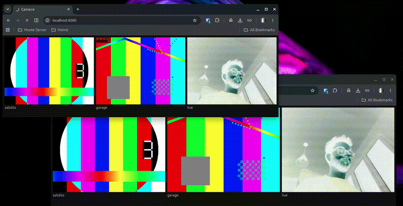

# TinyVideoStreamingServer

A lightweight C++20 MJPEG video streaming proxy server.

TinyVideoStreamingServer allows you to connect multiple MJPEG cameras and expose their video streams through a single HTTP server.

---




## Features

- Multiple camera support
- HTTP MJPEG streaming
- JPEG snapshot endpoint
- Simple web interface to view all cameras
- Configurable port, bind address and connection limits
- Lightweight, asynchronous networking using Boost.Asio
- Docker support
- Optional HTTPS support through Caddy

## Usage

```bash
mjpeg-proxy [options] <name>=<camera_url> [...]
```

Example:

```bash
mjpeg-proxy \
    --port 8080 \
    living-room=http://192.168.1.50:81/stream \
    garage=http://192.168.1.51:81/stream
```

### Options

| Option | Default | Description |
|---|---|---|
| `--port N` | `8080` | HTTP listening port |
| `--bind ADDR` | `0.0.0.0` | Listening address |
| `--max-clients N` | `32` | Maximum clients per camera |
| `--max-connections N` | `256` | Maximum total connections |
| `-h, --help` | | Show help |

## Endpoints

| Endpoint | Description |
|---|---|
| `/` | Camera overview |
| `/<camera>/` | Individual camera page |
| `/<camera>/stream` | MJPEG video stream |
| `/<camera>/snapshot.jpg` | Latest JPEG snapshot |
| `/healthz` | Health check |

## Build

Requirements:
- C++20 compiler
- CMake 3.20+
- Boost

```bash
cmake -S . -B build -DCMAKE_BUILD_TYPE=Release
cmake --build build -j$(nproc)
```

The executable will be available at:

```bash
./build/mjpeg-proxy
```

## Docker

Build the image:

```bash
docker build --target proxy -t tiny-video-streaming-server .
```

Run it:

```bash
docker run -d \
    --name mjpeg-proxy \
    -p 8080:8080 \
    tiny-video-streaming-server \
    living-room=http://192.168.1.50:81/stream
```

## License

See repository license information.